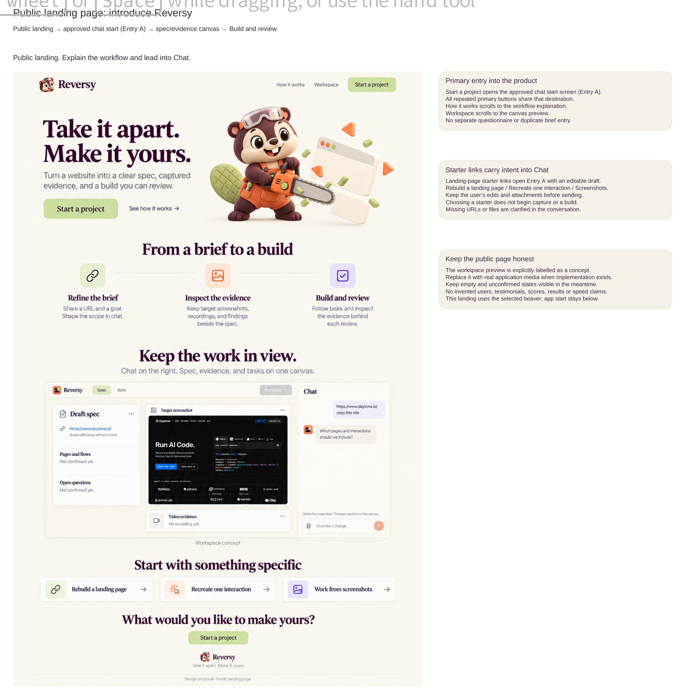
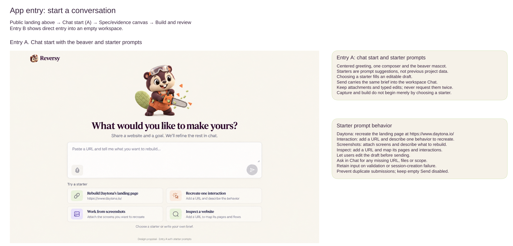
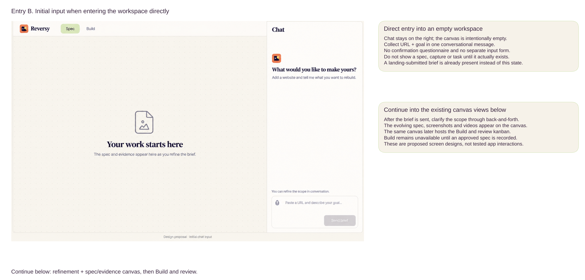
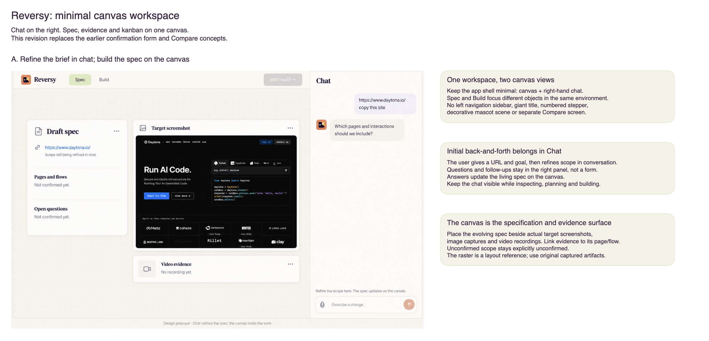
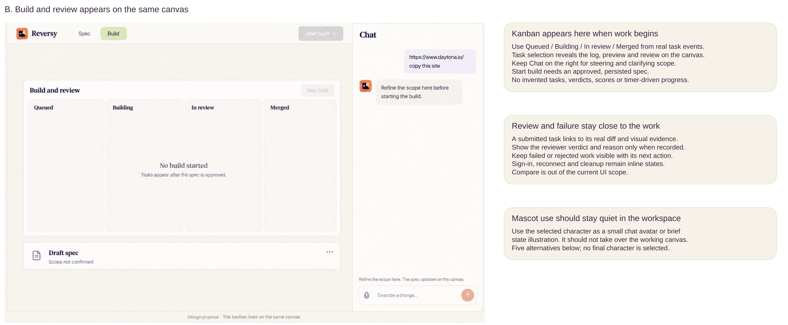
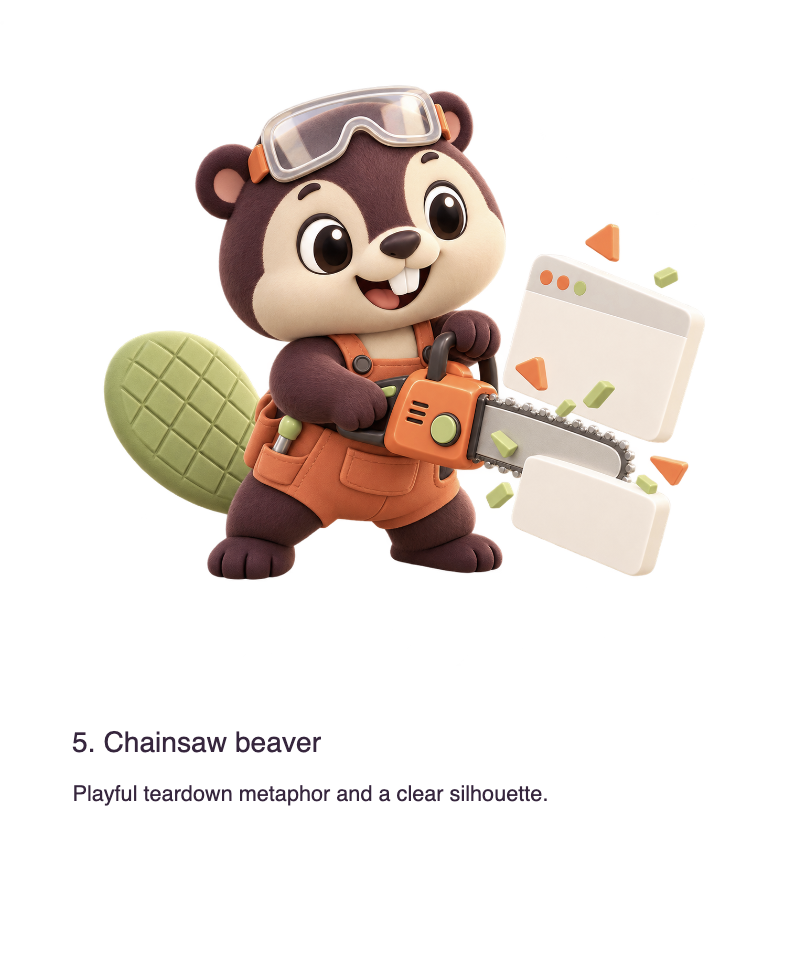

# Reversy: product spec

Reversy ("Take it apart. Make it yours.") is a reverse-engineering assistant.
The user gives a site and a goal in chat, refines the scope in conversation, and watches agents inspect the site and rebuild it on a shared canvas.
Daytona HackSprint, New York, 16 October 2026.

This file and [`orchestrator/spec.md`](orchestrator/spec.md) sit alongside *Reversy implementation specification, Revision 2* (the detailed handoff: routes, schemas, limits, security and acceptance tests).
Where this repo records a decision made after Revision 2, it wins; the decisions are listed in section 8.
Design source: the team's Excalidraw board ("Reversy: minimal canvas workspace"), captured in `docs/screens/`.
That board revision replaces the earlier confirmation form, six-stage stepper and Compare concepts.

## 1. Public landing page and app entry

The path into the product: public landing page → chat start (Entry A) → Spec canvas → Build and review.

### Public landing page

The landing page introduces Reversy, explains the workflow and leads into chat.

- **Header:** Reversy (beaver logo), "How it works" (scrolls to the workflow), "Workspace" (scrolls to the workspace preview), and **Start a project**.
- **Hero:** "Take it apart. Make it yours." with "Turn a website into a clear spec, captured evidence, and a build you can review.", **Start a project**, "See how it works", and the chainsaw beaver.
- **From a brief to a build:** three steps. Refine the brief (share a URL and a goal, shape the scope in chat); Inspect the evidence (target screenshots, recordings and findings beside the spec); Build and review (follow tasks and inspect the evidence behind each review).
- **Keep the work in view:** "Chat on the right. Spec, evidence, and tasks on one canvas.", with the workspace preview labelled "Workspace concept".
- **Start with something specific:** three starter links: Rebuild a landing page, Recreate one interaction, Work from screenshots.
- **Closing call:** "What would you like to make yours?" with **Start a project**, then the footer.

Rules:

- Every **Start a project** button opens Entry A. There is no separate questionnaire or duplicate brief entry.
- A starter link opens Entry A with an editable draft. Choosing a starter never begins capture or a build; a missing URL or file is asked for in chat.
- The page stays honest: the workspace preview is labelled as a concept until real app media replaces it, and there are no invented users, testimonials, scores, results or speed claims.

### Entry A: chat start

- A centred greeting ("What would you like to make yours?", "Share a website and a goal. We'll refine the rest in chat."), one composer and the beaver.
- Four starters, which are prompt suggestions rather than past projects: Rebuild Daytona's landing page (`https://www.daytona.io/`), Recreate one interaction, Work from screenshots, Inspect a website.
- A starter fills an editable draft; Send carries the same brief into the workspace chat.
- Keep attachments and typed edits through validation or session failures, never ask for them twice, prevent duplicate submissions, and keep Send disabled while empty.

### Entry B: direct entry into an empty workspace

- Opening the workspace directly shows an empty canvas ("Your work starts here: the spec and evidence appear here as you refine the brief.") with the chat on the right asking for a URL and goal in one message.
- No questionnaire or input form, and no spec, capture or task card until it actually exists.
- A brief sent from the landing page or Entry A arrives already in the chat instead of this empty state.

## 2. Session workspaces: canvas on the left, chat on the right

Each run has its own workspace: a canvas plus a right-hand chat.
There is no left navigation sidebar, giant title, numbered stepper, decorative mascot scene or separate Compare screen.
The header holds the Reversy name, session menu, **Spec**, **Build** and **Preview** views, and a **Start build** button.
Session navigation, browser persistence and canvas controls are documented in the [workspace usage guide](../README.md#workspace).

**Chat is how the user and Reversy talk.**
The user gives a URL and a goal, then refines the scope in conversation; questions and follow-ups stay in the chat panel, not in a form.
Answers update the living spec on the canvas.
The chat stays visible while Reversy inspects, plans and builds, and is where the user steers and clarifies scope.
Reversy addresses the user as "you", without a title or nickname.

**The canvas holds the work.**
Spec and Build show different objects in the same environment.

## 3. Spec view: refine the brief in chat, build the spec on the canvas

The canvas is the specification and evidence surface:

- **Draft spec** card: the target URL, pages and flows, and open questions. Anything not yet agreed is shown as "Not confirmed yet".
- **Target screenshot** cards follow the [workspace guide's screenshot and unavailable-evidence behavior](../README.md#workspace).
- **Video evidence** cards: real recordings from the [evidence contract](orchestrator/spec.md#6-evidence), or "No recording yet".
- Each piece of evidence links to its page or flow.

The board's raster is a layout reference only; the live canvas shows the original captured artifacts.
When a page needs an account, an inline state asks the user to open secure sign-in or skip that page.

## 4. Build view: build and review on the same canvas

- **Start build** is enabled when the run reaches `planned`. Before tasks arrive, the board shows the run's inspection, planning, plan-ready or building phase; otherwise it reads "No build started. Tasks appear after the spec is approved."
- The kanban has four columns, **Queued**, **Building**, **In review** and **Merged**, driven by real task events. **Stop build** halts the work.
- Selecting a task opens its log, preview and review on the canvas.
- A submitted task links to its real diff and visual evidence. The reviewer's verdict and reason appear only once recorded.
- Failed or rejected work stays visible with its next action.
- Sign-in, reconnect and cleanup appear as inline states.
- The draft spec card stays on the canvas below the board.
- No invented tasks, verdicts, scores or timer-driven progress.

**Steering:** the user can message the orchestrator at any time and override a review verdict.
A message that changes the approved spec becomes a proposed change; applying it creates a new spec revision for approval rather than editing a running build.

## 5. Scope for this version

Demo target: `https://www.daytona.io/` (Daytona has agreed).
Two pieces of work run in parallel, each split into tasks on the kanban:

1. **Landing page, in detail.** A faithful rebuild of the daytona.io landing page, plus three alternative versions of it. Each alternative comes with a short explanation, shown on the canvas, of how it changes the page and the visitor's path through it.
2. **One signed-in flow:** create a sandbox, with a mock back end that has the same routes and response shapes as the original. v2 rebuilds the back end properly.

The three alternatives are pods forked from the finished landing-page rebuild.
Daytona VM fork is the target; until it is enabled on our account, pods are copies from a snapshot and labelled as copies.
The user can promote an alternative; building then continues from that alternative's snapshot.

At the end of a run, the user gets the rebuild as a live preview inside the app, with an optional action to deploy it live.

### Financial reports (not in the demo)

Financial reports are left out of the demo for now.
Later, Reversy can reconstruct financial reports as well as websites.
Given a published report, it rebuilds the tables, charts and key figures as an editable, working version, and every number links back to the place in the source where it was found.
It uses the same loop as a site: chat to agree scope, evidence captured from the source, a plan of tasks on the kanban, review against the evidence, and verification.
A figure Reversy could not read is marked "not observed", never filled in.

## 6. Mascot

The mascot is the **chainsaw beaver**: a playful teardown metaphor with a clear silhouette (safety goggles, orange overalls, pistachio tail, chainsaw cutting a browser window apart).
It stays quiet in the workspace: a small chat avatar or a brief state illustration, never taking over the working canvas.
The current image is concept art, not a final brand asset.
The other four options on the board (chainsaw robot, spanner raccoon, toolkit octopus, clockwork beetle) are not used.

## 7. Look and feel

All frontend work follows `.claude/skills/frontend-design/SKILL.md`; where the board and Revision 2 set the direction, they win.

- Palette: Aubergine `#39253F` (text, key controls), Pistachio `#C4DB9B` (gentle highlights, active view), Persimmon `#EB7957` (calls to action, active work), Parchment `#F6F2E9` (background). Status always pairs colour with text and an icon, and error red must differ from persimmon.
- Type: Fraunces for headings, Manrope for body and controls, a readable monospace for logs.
- Canvas: soft dotted background, white rounded cards with thin borders, restrained shadows.
- Controls are real HTML, and every state comes from real data.

## 8. Platform and decisions

| Piece | Use |
|---|---|
| Cloudflare Workers | Hosts the web app and its API, and the Reversy orchestrator (one Durable Object per run) behind it |
| Daytona | Runs the Codex workers in one sandbox per run (Daytona Tier 3 or higher, Tier 3 confirmed on the account dashboard; full internet access); preview URLs; VM fork for variants once enabled |
| Anchor | Essential: the browser for [evidence capture](orchestrator/spec.md#6-evidence) and for secure sign-in, where the user signs in themselves |
| SurrealDB | Main data store (runs, tasks, reviews, verdicts, canvas) and Agent Memory for observations and decisions with their sources |
| Arize | Stores the traces: one per run across inspection, planning, building, review and verification |
| GPT 6.1 via the OpenAI API | Orchestrator (also the chat agent), Codex workers, review and the verifier; all models are OpenAI |

Decided since Revision 2, which lists these as open or says otherwise:

- First site: daytona.io, with Daytona's permission.
- Repository: new, `AnalystTom/daytona_hack`.
- Runtime models: all OpenAI, GPT 6.1 for the agents and the verifier.
- Hosting: Cloudflare Workers.
- Build engine: the Reversy orchestrator, a Cloudflare Durable Object per run, enhanced with full Anchor capture, running Codex workers in one Daytona sandbox. Workers run commands inside their sandbox, replacing Revision 2's no-shell agent loop. Firstmate in Daytona with no-mistakes review is a second engine for later.
- The orchestrator is private: only our site calls it, and only we can test it.
- Daytona Tier 3 or higher: the sandbox has full internet access.
- Each run is limited to 2 hours.
- A verifier failure on a merged task opens a fix task and the build continues, with no rollback.
- Recordings are capped at 30 seconds.
- Runs are secure: a run ID alone never gives access; every run route requires the existing OPERATOR_TOKEN; after the operator enters that token once, the browser holds a signed, expiring, HttpOnly session cookie instead, so the app and event stream work.
- Out of the demo for now: REA, financial reports, and user accounts, sign-ups or a login system (the existing token gates stay).
- Scope: landing page plus one flow, built in parallel, with three landing-page alternatives. This replaces Revision 2's limit of two pods.
- SurrealDB is the main store as well as Agent Memory, not an optional extra.
- UI: the [session workspace](#2-session-workspaces-canvas-on-the-left-chat-on-the-right) replaces Revision 2's six screens, stepper, confirmation form and Compare screen.
- Mascot: the chainsaw beaver replaces the cream robot.

Still open: the hard spend cap, and which sponsor accounts actually work.
